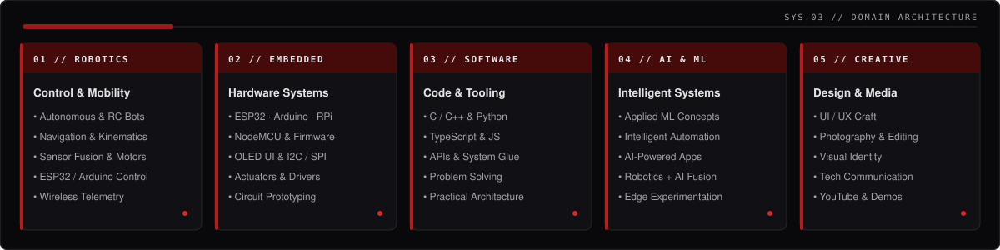
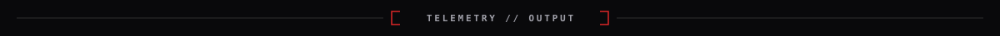
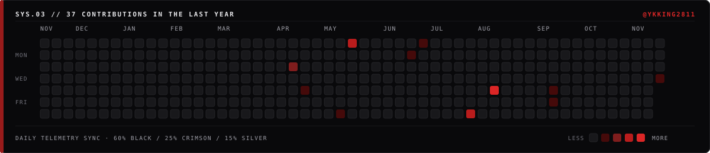
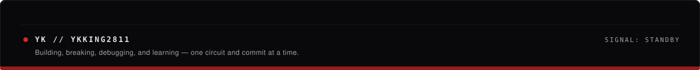

  

 

  <strong>A Computer Science student exploring the intersection of software, robotics, electronics, and intelligent systems.</strong>
   
  <code>60% BLACK</code> · <code>25% CRIMSON</code> · <code>15% SILVER</code> — Personal Engineering Workspace

 

  

## 01 // About Me

I'm **YK** (`ykking2811`) — a Computer Science and Engineering student, robotics enthusiast, and technology hobbyist who prefers hands-on experimentation over purely theoretical study.

I learn best by **building, breaking, debugging, and iterating**—whether that means wiring sensors to an ESP32, tuning motor control on a chassis, writing C++ or Python to tie hardware to software, or refining an interface until it feels right. I'm actively learning, exploring unconventional approaches, and turning ideas into functional real-world prototypes.

---

## 02 // Technical Interests & Stack

  

 

| Layer | Focus Areas & Tools |
| :--- | :--- |
| **Robotics & Control** | Autonomous & mobile bots · Motor drivers · Sensor integration · Navigation logic · Wireless RC |
| **Embedded & Hardware** | `ESP32` · `Arduino` · `NodeMCU` · `Raspberry Pi` · `OLED (I2C/SPI)` · Circuit prototyping |
| **Languages & Software** | `C` · `C++` · `Python` · `TypeScript` · `JavaScript` · `HTML/CSS` · APIs & system integration |
| **AI & Automation** | Machine learning fundamentals · Intelligent automation · AI-assisted workflows & robotics |
| **Creative Tech** | UI/UX experimentation · Visual identity · Photography · Technical video & communication |

---

  

## 03 // GitHub Statistics & Activity

  

 

  <table>
    <tr>
      <td align="center" width="50%">
        
      </td>
      <td align="center" width="50%">
        
      </td>
    </tr>
  </table>

---

## 04 // Featured Projects

### Selected Repositories

<table>
  <tr>
    <td width="33%" valign="top">
      <strong><a href="https://github.com/ykking2811/portfolio">portfolio</a></strong>
       
      <code>TypeScript</code>
        
      Personal web portfolio exploring clean typography, layout craft, and responsive frontend architecture.
    </td>
    <td width="33%" valign="top">
      <strong><a href="https://github.com/ykking2811/Ticketer">Ticketer</a></strong>
       
      <code>JavaScript</code>
        
      Web application project focused on structured ticketing workflows, state handling, and interactive UI.
    </td>
    <td width="33%" valign="top">
      <strong><a href="https://github.com/ykking2811/student-records">student-records</a></strong>
       
      <code>HTML</code>
        
      Lightweight student record management interface built around clarity and structured data entry.
    </td>
  </tr>
</table>

### Hardware & Lab Explorations

> Hands-on builds and prototypes from my personal electronics and robotics workbench.

<table>
  <tr>
    <td width="50%" valign="top">
      <strong>Autonomous &amp; RC Robotics</strong>
       
      <code>Arduino</code> · <code>ESP32</code> · <code>Motor Control</code>
        
      Mobile robot platforms built for competition and experimentation—combining ultrasonic/IR sensing, motor driver calibration, and wireless control.
    </td>
    <td width="50%" valign="top">
      <strong>ESP32 Wireless Control &amp; IoT</strong>
       
      <code>ESP32</code> · <code>NodeMCU</code> · <code>C++</code>
        
      Low-latency wireless control links and sensor-driven automation nodes bridging physical actuators with software dashboards.
    </td>
  </tr>
  <tr>
    <td width="50%" valign="top">
      <strong>OLED Interactive Devices</strong>
       
      <code>I2C/SPI</code> · <code>Embedded UI</code>
        
      Compact microcontroller gadgets using monochrome OLED displays for live telemetry readouts, status menus, and interactive feedback.
    </td>
    <td width="50%" valign="top">
      <strong>Experimental Electronics &amp; Prototypes</strong>
       
      <code>Raspberry Pi</code> · <code>Debugging</code>
        
      Breadboard-to-enclosure iterations testing unconventional hardware-software combinations and practical problem solving.
    </td>
  </tr>
</table>

---

## 05 // Currently Exploring

- **Embedded Systems & Robotics**: Tighter real-time control loops, sensor fusion, and reliable wireless telemetry on `ESP32`.
- **AI + Hardware Integration**: Bringing lightweight ML and intelligent automation closer to physical devices.
- **Software Craft**: Strengthening `C++`, `Python`, and `TypeScript` fundamentals through practical builds.
- **Visual & UI Craft**: Designing interfaces and technical media that feel intentional and tactile.

---

## 06 // Connect

- **GitHub**: [@ykking2811](https://github.com/ykking2811)
- **YouTube**: [TechGeniusYK](https://www.youtube.com/c/TechGeniusYK)
<!-- - **Portfolio**: [your-domain.com](https://your-domain.com) -->
<!-- - **LinkedIn**: [linkedin.com/in/your-handle](https://linkedin.com/in/your-handle) -->
<!-- - **Email**: [you@example.com](mailto:you@example.com) -->

 

  

